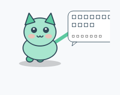

# LitePet · 桌面宠物

> OpenLab 2026 纳新笔试 · 第 4 题「君子六艺——御」· **二档·桌宠**（并完成了两项扩展任务）

一只住在你桌面上的猫：会自己走动、会眨眼、会说话；你可以戳它、拖它、喂它、给它换颜色；关掉程序再打开，它还记得你上次是什么时候离开的。



---

## 1. 快速开始

```bash
# 1) 安装依赖（只需要一个）
pip install PySide6

# 2) 启动
python -m litepet

# 常用参数
python -m litepet --name 小花        # 起名字
python -m litepet --theme peach      # 换配色（mint / peach / night）
python -m litepet --pause            # 启动后不自己乱走
python -m litepet --reset            # 清空存档，重新开始
python -m litepet -v                 # 输出调试日志
```

> **环境**：Python 3.10+ / Windows、macOS、Linux 均可。Windows 上无边框透明窗口效果最好。

## 2. 交互一览

| 操作 | 效果 |
| :--- | :--- |
| 左键**单击** | 戳它一下，它会随机说句话，好感度 +1 |
| 左键**拖拽** | 把它拖到屏幕任意位置，位置会被记住 |
| 左键**双击** | 坐下 / 起来（切换是否到处走） |
| **右键** | 菜单：喂小鱼干、换配色、暂停走动、查看统计、退出 |
| `Ctrl+Alt+P` | 归位到屏幕右下角 |
| `Ctrl+Alt+H` | 隐藏 / 显示 |
| `Ctrl+Alt+Q` | 退出（自动存档） |

## 3. 已完成的能力

**二档·桌宠（必做）**

- [x] 常驻桌面：无边框 + 透明背景 + 置顶 + 不进任务栏
- [x] 有界面：整只猫用 `QPainter` 画出来，**零外部图片依赖**
- [x] 点击：戳一下就说话
- [x] 拖拽：按住鼠标随便拖
- [x] 说话：头顶气泡，按当前时段说不同的话
- [x] 走动：自主游走，撞到屏幕边缘会反弹

**扩展任务（选做，做了两项）**

- [x] **持久化**：`~/.litepet/state.json` 保存名字、好感度、位置、聊天历史、上次见面时间；再打开时会说「你回来啦，我数了你好久」这种按离开时长分级的话
- [x] **随时间/环境变化**：六个时段（清晨/上午/中午/下午/傍晚/深夜）的移动速度、困倦程度、台词都不一样——深夜它会趴着打瞌睡，头顶冒 `Zzz`；另外内置 5 个**定时提醒**（9:00 喝水、12:00 吃饭、15:00 活动、18:00 收工、23:00 睡觉）
- [x] **新的交互/输出方式**：全局快捷键、右键菜单、日志文件 `~/.litepet/pet.log`（每一句话都会记进去）

**三档·让它活起来（部分）**

- [x] 本地记忆（关掉再打开还记得聊过什么）
- [x] 定时提醒
- [ ] 接 llama-server 对话（需先完成第 3 题编译出本地模型服务，接口已在 `brain.py` 留好扩展位）
- [ ] 语音播报（本机没有可用的 TTS 引擎，暂缺）

## 4. 目录结构

```
src/q4_litepet/
├── README.md              本文件
├── requirements.txt       依赖
├── litepet/               源码包
│   ├── __init__.py
│   ├── main.py            入口：参数解析 + 组装 + 启动
│   ├── window.py          窗口层：走动动画、拖拽/点击/菜单/快捷键、定时提醒
│   ├── sprite.py          绘制层：QPainter 画猫 + 对话气泡 + 三套配色
│   ├── brain.py           逻辑层：时段判断、台词库、好感度与心情（纯逻辑，可单测）
│   └── memory.py          存储层：JSON 持久化 + 日志（原子写，坏档自动兜底）
└── tests/
    ├── test_brain.py      16 个单元测试（纯逻辑，无需显示器）
    └── smoke_gui.py       GUI 冒烟测试：构造 → 200 帧动画 → 渲染 → 存档 → 退出
```

**为什么这么分层**：`brain.py` 和 `memory.py` 完全不 import 任何 Qt 模块，所以它们能在没有显示器的环境里跑测试——这也是我能给"情绪/台词/存档"这种容易写错的逻辑加上单测的原因。GUI 层只负责画和收事件。

## 5. 跑测试

```bash
python tests/test_brain.py            # 纯逻辑单测
python tests/smoke_gui.py             # GUI 冒烟（有界面时）
QT_QPA_PLATFORM=offscreen python tests/smoke_gui.py   # 无界面/CI 时
```

## 6. 三个关键模块说明

**① `brain.Brain.say()` —— 台词决策**
数据从哪来：调用方传入的事件名（`greet` / `click` / `idle` / `fed`）+ 从 `datetime.now()` 拿到的小时数 + 存在 `PetState` 里的好感度。
到哪去：先从 `LINES` 这个"事件 → 时段 → 台词列表"的字典里取出候选池，用带种子的随机数挑一句，写进 `state.history`，再作为返回值交给窗口画气泡。
为什么要"带种子"：随机数可复现，单测才能断言两次 `poke()` 结果一致。

**② `memory.Memory.save()` —— 持久化**
数据从哪来：`PetState.to_dict()` 序列化出的字典 + 当前时间（写入 `last_seen`）。
到哪去：先 `mkstemp` 写临时文件，`json.dump` 落盘，再 `os.replace` 原子替换掉旧存档。这样即便写到一半断电/崩溃，旧存档也还是完整的。读取时如果 JSON 解析失败，会把坏档改名成 `.bak` 然后返回默认状态——宠物不会因为存档坏了就打不开。

**③ `window.PetWindow._on_tick()` —— 主循环**
数据从哪来：`brain.behavior()` 给的当前时段速度倍率与困倦度、`self.vx/vy` 当前方向、屏幕 `availableGeometry()`。
到哪去：每 40ms 更新一次坐标和 `walk_phase`（走路动画相位），撞边反弹并 clamp 回屏幕内，然后 `self.move()` + `self.update()` 触发重绘。同一个 tick 里还顺手处理眨眼计时和整点提醒。把"算位置"和"画"分开，是因为重绘可能因为遮挡被跳过，但状态必须持续推进。

## 7. 已知限制

- 透明窗口在某些 Linux 桌面环境（非合成器）下会显示成黑底，Windows / macOS 正常。
- 全局快捷键走的是 Qt 的 ApplicationShortcut，只在程序运行时生效（这是刻意的，不希望它在后台抢系统按键）。
- 台词库是硬编码的中文，没有做多语言。
