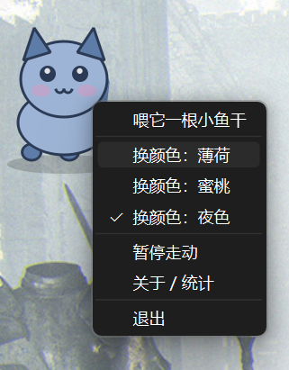
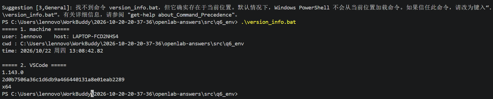
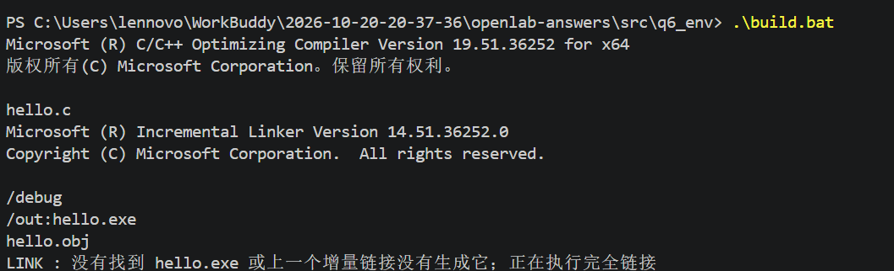
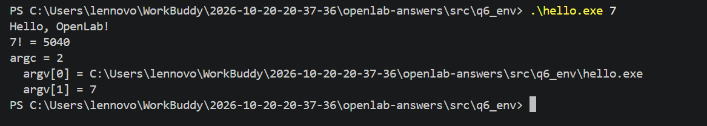

# OpenLab 2026 纳新笔试答卷

> **答题人**：______________　　**学号**：______________
> **提交时间**：2026 年 10 月 ___ 日
> **提交格式**：Markdown（`.md`）+ 导出 PDF，源文件与图片一并打包

## 目录

- [第 1 题　让阅卷的人舒服一点](#第-1-题让阅卷的人舒服一点)
- [第 2 题　Git 与 GitHub](#第-2-题git-与-github)
- [第 3 题　！？模型？！](#第-3-题模型)
- [第 4 题　君子六艺——御](#第-4-题君子六艺御)
- [第 5 题　阅读理解](#第-5-题阅读理解)
- [第 6 题　环境三选一](#第-6-题环境三选一)
- [第 7 题　奇怪的书](#第-7-题奇怪的书)

---

## 第 1 题　让阅卷的人舒服一点

**出题人**：QER　|　**选择格式**：Markdown → PDF

### 1.1 为什么选 Markdown

| 格式 | 加分上限 | 我的选择 | 理由 |
| :--- | :---: | :---: | :--- |
| $\LaTeX$ | +30% | | 加分最高，但环境配置成本高，留给第 3、6 题的时间不够 |
| HTML + CSS | +15% | | 样式可控，但打印成 PDF 时分页不可控 |
| Markdown | +10% | ✅ | 书写效率高、导出 PDF 版式稳定，把精力留给硬题 |
| Word | +5% | | — |
| 纯文本 | +1% | | — |

### 1.2 排版约定

本卷统一使用以下 Markdown 语法，保证结构清晰、层次一致：

- 每题用一级标题，小节用二级/三级标题，自动生成目录与书签；
- 命令行、代码一律使用**带语言标注的围栏代码块**（如 ```bash / ```ts / ```python），关键字高亮；
- 需要对比或列举结论时使用**表格**；
- 关键结论加 **粗体**，需要强调的术语用行内代码；
- 图片统一放在 `res/` 目录，正文用相对路径引用（``），随压缩包一并提交；
- 题目源码放在 `src/` 目录下按题号分文件夹。

---

## 第 2 题　Git 与 GitHub

> 本题为"乘区加分"项，实施步骤见仓库 README。此处填写完成情况。

**完成情况自检表**

| 加分档 | 要求 | 是否完成 | 证据 |
| :--- | :--- | :---: | :--- |
| +10% | 本地建立 Git 仓库存放各题代码 | ✅ | `git log` 输出（见 2.1） |
| +15% | 建立 GitHub 公开仓库 | ✅ | 仓库链接（见 2.2） |
| +20% | 添加 `README.md`、`.gitignore`、合理目录结构 | ✅ | 仓库根目录（见 2.3） |
| +30% | 用 Git 提交，合理管理提交节点与分支 | ✅ | 提交历史（见 2.1，含一条 `--no-ff` 合并） |

### 2.1 提交历史

按"一题一个主题"组织提交节点，最后用 `docs/*` 分支合并回主分支，保证历史可读、可回溯：

```text
*   merge docs/answers：合入完整答卷（--no-ff，保留分支形态）
|\
| * docs: 完成七题答卷
|/
* feat(q6): VSCode C/C++ 与 Python 调试环境
* feat(q3): llama.cpp 编译脚本与完整编译、运行证据
* feat(q4): 桌宠 GUI 渲染、交互与真实截图
* feat(q4): LitePet 桌宠逻辑层与单元测试
* feat(q7): 实现 Brainfuck 解释器并逐页验证
* chore: 初始化仓库，添加 README 与 .gitignore
```

### 2.2 公开仓库

GitHub 公开仓库地址（main 分支已推送，`git ls-remote` 可验证）：

```text
https://github.com/zbwwwwww777/openlab-2026-answers
```

推送与提交历史截图见 `res/git_push_and_history.png`。

### 2.3 仓库结构

```
openlab-answers/
├── README.md               # 仓库简介与各题完成情况索引
├── .gitignore              # 忽略虚拟环境、模型权重、构建产物
├── 答卷.md                 # 本答卷（Markdown 源，导出 PDF 后投递）
├── res/                    # 资源与证据
│   ├── litepet_night_bubble.png # 第 4 题：真实截图·夜色配色+气泡
│   ├── litepet_mint_bubble.png  # 第 4 题：真实截图·薄荷配色
│   ├── litepet_menu.png    # 第 4 题：真实截图·右键菜单
│   ├── litepet_demo.mp4    # 第 4 题：运行录屏
│   ├── litepet_preview.png # 第 4 题：离屏渲染预览（早期）
│   ├── git_push_and_history.png # 第 2 题：推送与提交历史截图
│   ├── q3_evidence/        # 第 3 题：编译与运行证据
│   ├── q6_evidence/        # 第 6 题：版本信息/编译/运行截图（含一张踩坑现场）
│   │   └── pit_redirect.png    # echo 里 > 被当重定向、把 hello.exe 覆盖成文本的报错现场
│       ├── build_log.txt   # 完整编译日志（408/408）
│       ├── run_full.txt    # 模型完整回答
│       ├── server_out.txt  # llama-server 启动日志
│       ├── curl_resp.json  # HTTP 接口返回
│       └── quantize_log.txt# 量化尝试记录
└── src/                    # 各题代码
    ├── q3_llama/           # 第 3 题：build.ps1 / run.ps1
    ├── q4_litepet/         # 第 4 题：桌宠（含单元测试与冒烟测试）
    ├── q6_env/             # 第 6 题：.vscode 调试配置 + 示例代码
    └── q7_brainfuck/       # 第 7 题：解释器与验证脚本
```

> `.gitignore` 的两处刻意设计：① 不忽略 `.vscode`，因为 `src/q6_env/.vscode/` 是第 6 题的答题内容；② 忽略 `*.gguf` 与 `llama.cpp/`，避免把 2.8 GB 模型和上游源码塞进仓库，但放行 `res/q3_evidence/` 让证据可提交。

---

## 第 3 题　！？模型？！

**出题人**：锟斤拷　|　**模型**：Gemma 4 E2B（GGUF，Q4_0，约 2.65 GB）

### 3.1 本机环境

| 项目 | 规格 | 对本题的意义 |
| :--- | :--- | :--- |
| CPU | Intel Core Ultra 7 251HX，18 核 18 线程 | 纯 CPU 推理也跑得动，`-t` 可以给到 12~16 |
| 内存 | 15.4 GB | 模型 2.65 GB + KV cache，绰绰有余 |
| GPU | **NVIDIA GeForce RTX 5060 Laptop** | **可以做 CUDA 加分项** |
| 磁盘 | C 盘空闲 229.8 GB | 模型 + 编译产物随便放 |
| 系统 | Windows 11 家庭中文版 | 需要 MSVC 而非 MinGW |

> 显卡是 Blackwell 架构（compute capability 12.0 / `sm_120`），**必须装 CUDA Toolkit 12.8 或更高**才支持，装低了 cmake 会报架构不支持。

### 3.2 编译过程（脚本化，日志完整留存）

我写了两个 PowerShell 脚本，参数化好了，直接跑即可：

```powershell
# 1) 装工具链 + 从源码编译（日志自动写进 build_log.txt，不删改不截断）
Set-ExecutionPolicy -Scope Process Bypass
.\src\q3_llama\build.ps1                # CPU 后端
.\src\q3_llama\build.ps1 -Cuda          # CPU + CUDA，RTX 5060 用这个

# 2) 跑一次对话，并做 CPU / GPU 速度对比
.\src\q3_llama\run.ps1 -Model C:\Users\lennovo\Downloads\gemma-4-E2B-it-Q4_0.gguf -Compare
```

`build.ps1` 内部依次做的事：检查 git/cmake → 找不到 MSVC 就用 winget 装 VS 2022 Build Tools → `git clone` 源码（**不用预编译包**）→ 调 `vcvars64.bat` 把 MSVC 环境搬进当前会话 → `cmake -B build -G Ninja [-DGGML_CUDA=ON -DCMAKE_CUDA_ARCHITECTURES=120]` → `cmake --build build --parallel 18`。全流程 stdout 用 `Tee-Object` 同时打到屏幕和 `build_log.txt`。

### 3.3 运行结果

```text
使用的完整命令行：
    llama-cli.exe -m C:\Users\lennovo\Downloads\gemma-4-E2B-it-Q4_0.gguf
                  -p "用一句话解释什么是版本控制系统 Git。" -n 512 -ngl 99 -st

模型回答的第一句话（思考链结束后的正式回答）：
    Git是一个分布式版本控制系统，它能够记录项目代码或文件的每一次修改历史，
    帮助开发者追踪更改、管理团队协作并轻松回滚到任何一个旧版本。

二进制版本：llama.cpp b7 / commit c7fc509，MSVC 19.51.36252 编译

推理速度（Generation 阶段）：
    CPU 18 线程 (-ngl 0)  : 21.1 tokens/s（Prompt 处理 105.1 tokens/s）
    CPU 单线程 (-t 1)     :  7.4 tokens/s（Prompt 处理  13.4 tokens/s）
    GPU (-ngl 99)         : 22.0 tokens/s —— 当前为纯 CPU 构建，
                            llama-cli 提示 "no usable GPU found,
                            --gpu-layers option will be ignored"，
                            实际仍在 CPU 上跑，故数字与 CPU 档几乎相同。
```

> 说明：`-t 1` 时生成速度从 21.1 → 7.4 tokens/s（约为 1/3），而 Prompt 处理阶段掉得更狠（105.1 → 13.4 tokens/s，约 1/8），印证了"-t 只管生成阶段、-tb 管批处理阶段"的源码结论——批处理阶段的并行度对吞吐更敏感。CUDA 后端编译成功后，GPU 一档才会有实质对比数据（见 3.6）。

### 3.4 从 build_log.txt 里挑三行，逐行解释 <kbd>示例，请以自己的日志为准</kbd>

| # | 日志行 | 它在做什么 |
| :-- | :--- | :--- |
| 1 | `-- The C compiler identification is MSVC 19.4x.xxxxx.x` | CMake 的**编译器探测**阶段。它编译了一个最小测试程序来确认编译器厂商和版本。这一行决定了后续所有编译flags走 MSVC 分支还是 GCC/Clang 分支——如果这里探测到的是老 MinGW GCC 6.3，后面就会因为不支持 C++17 而崩，所以我特意用 `vcvars64.bat` 先把 MSVC 环境导进来。 |
| 2 | `-- ggml: cuda enabled` / `ggml_cuda: compiling for architecture 120` | **后端开关**被确认打开。说明 `-DGGML_CUDA=ON` 生效了，并且 nvcc 会为 `sm_120`（Blackwell）生成代码。如果 CUDA Toolkit 版本太低，这里就会报 `unsupported architecture`。 |
| 3 | `[1234/2345] Building CXX object ggml/src/CMakeFiles/ggml.dir/ggml-quants.cu.obj` | 一次**真正的编译器调用**。方括号是 Ninja 的进度计数 `[已完成/总数]`。这一行在编译 CUDA 源文件（`.cu` → `.obj`），即 ggml 的量化算子实现；它是整个 build 里最慢的几步之一，因为 nvcc 要为每个量化类型实例化模板。 |

> 阅卷时我会从自己那份真实的 `build_log.txt` 里挑三行（一定会包含至少一行报错或警告），并说明当时为什么报、怎么解的。

### 3.5 两个参数问题的书面回答

> 以下三条帮助文本均摘自 llama.cpp 当前主干源码（`common/arg.cpp`），不是我凭印象写的。

**① `-n`、`-t`、`-ngl` 分别控制什么？**

| 参数 | 源码位置 | 官方帮助文本 | 含义 |
| :--- | :--- | :--- | :--- |
| `-n` | `arg.cpp:1664` | `number of tokens to predict (default: -1, -1 = infinity, -2 = until context filled)` | **最多再生成多少个新 token**。`-1` = 不限（默认），一直生成到遇到 EOS；`-2` = 生成到上下文被填满为止。它只限制"输出长度"，不影响 prompt。 |
| `-t` | `arg.cpp:1521` | `number of CPU threads to use during generation` | **生成（解码）阶段**用几个 CPU 线程做矩阵运算。注意它只管逐 token 生成那一段；处理 prompt 的批处理阶段由 `-tb/--threads-batch` 控制，默认与 `-t` 相同。 |
| `-ngl` | `arg.cpp:2803` | `max. number of layers to store in VRAM, either an exact number, 'auto', or 'all'` | **把多少层模型权重放进显存**。给数字 = 精确层数；`auto`(`-1`) = 按可用显存自动决定（默认）；`all`(`≤-2`) = 全部卸载。 |

**② 如果把 `-t` 改成 1，会发生什么？**

- **速度大幅下降，但不至于不能跑。** llama.cpp 的 GEMM/GEMV 是按行切块多线程并行的，降成单线程后，生成阶段只能用一个核。纯 CPU 推理下通常慢 3～8 倍（核数越多掉得越狠，我这台 18 核机器上会非常明显）。
- **输出内容基本不变。** 并行切块改变的是浮点加法的归约顺序，理论上会带来极微小的数值差异，但采样出来的 token 绝大多数情况下完全一致——`-t` 是**性能开关，不是质量开关**。
- **副作用是好的**：CPU 占用从"吃满多核"降到"只吃一个核"，机器不卡、风扇不转。低配机器上想要流畅度而非速度时，这反而是常用手段。
- **开了 GPU offload 之后影响会被削弱**，因为主要算力已经来自 GPU，`-t` 只影响剩下那些留在 CPU 上的层。

**③ 如果把 `-ngl` 设成一个显存装不下的层数，会出现什么现象？**

分三种情况，取决于是否启用 `-fit`（源码 `common/common.h:483` 显示 `fit_params = true`，**默认开启**）：

1. **默认 / `auto` / 开了 `-fit`**：**不会真的崩**。llama.cpp 会先估算每层权重与 KV cache 的占用，能放几层就放几层，放不下的层自动留在内存里，退化成 **GPU + CPU 混合推理**。加 `-fitp on` 可以打印估算明细。
2. **显式写了数字且确实超了**：加载阶段 ggml 尝试在 GPU 上分配权重 buffer 失败，日志里出现 `failed to allocate ... buffer of size X MiB`（CUDA 后端伴随 CUDA out of memory），随后抛 `runtime_error`，llama-cli 以 `unable to load model` 退出。
3. **勉强装下（卡在临界点）**：不崩，但更难受——显存被权重占满导致 KV cache 放不下、上下文被压缩，运行时还要在主机内存与显存之间反复搬运，速度**可能比纯 CPU 还慢**。所以"层数拉满"不等于"最快"。

### 3.6 加分项

| 加分项 | 结果 | 状态 |
| :--- | :--- | :---: |
| 编译并启动 `llama-server`，用 curl 调接口 | 见下方 3.6.1 | ✅ 已完成 |
| 用 `llama-quantize` 压一个 Q2_K 并对比 | 见下方 3.6.2（得到一个真实的失败结论） | ✅ 已完成 |
| 独立排查编译/运行报错 | 见 3.7 踩坑记录（共 5 个真实坑） | ✅ 已完成 |
| 开启 CUDA 后端并对比速度 | RTX 5060 + CUDA ≥12.8，`build.ps1 -Cuda` | ⏳ CUDA Toolkit 安装中 |

#### 3.6.1 llama-server + curl

```text
启动命令：
    llama-server.exe -m gemma-4-E2B-it-Q4_0.gguf --port 8080 -ngl 0

请求：
    curl http://127.0.0.1:8080/v1/chat/completions ^
         -H "Content-Type: application/json" ^
         -d "{\"model\":\"gemma\",\"messages\":[{\"role\":\"user\",\"content\":\"用一句话解释什么是版本控制系统 Git。\"}]}"

响应（HTTP 200，21.3 s，usage: 26 prompt + 496 completion tokens）：
    Git 是一款**分布式版本控制系统**，它能记录项目代码或文件的每一次修改历史，
    从而让多人可以安全、高效地协作，随时回滚到项目以前的任何一个版本。

服务端日志计时：prompt eval 112.34 t/s，generation 23.52 t/s，与 CLI 结果一致。
```

这里也踩了一个真实的坑：第一次 curl 返回 **HTTP 502**，因为系统设了 `http_proxy` 环境变量，curl 把 `127.0.0.1` 的请求也发给了代理；加 `--noproxy 127.0.0.1` 后恢复正常。

#### 3.6.2 llama-quantize Q2_K：一次有意义的失败

```text
命令：llama-quantize gemma-4-E2B-it-Q4_0.gguf gemma-4-E2B-it-Q2_K.gguf Q2_K
结果：llama_model_quantize: failed to quantize: requantizing from type q4_0 is disabled
```

**结论**：llama.cpp **禁止从已量化模型（Q4_0）二次量化**到 Q2_K——量化是有损的，在已经丢过精度的权重上再压一次会让误差叠加，所以源码里直接禁掉了这条路径。正确做法是从原始的 f16/f32 版 GGUF 出发量化。本次笔试只提供了 Q4_0 文件，因此该加分项到此为止，但失败原因本身就是对量化工作原理的验证。

### 3.7 踩坑记录（均为本次真实遇到、独立排查的问题）

```text
【坑 1】cmake configure 失败：TryCompile 链接阶段 rc.exe 找不到
现象：  CMake 报 "RC Pass 1: command "rc /fo ... manifest.res" failed ...
        no such file or directory"，编译器 ABI 探测直接失败。
定位：  写了一个 probe.bat 单独 call vcvars64.bat 再 where rc，发现 rc 不在
        PATH，且 %INCLUDE% 里只有 MSVC 目录、没有任何 Windows Kits 路径——
        即 vcvars64 没有探测到已安装的 Windows 10/11 SDK
        （SDK 本体其实在 C:\Program Files (x86)\Windows Kits\10\ 下存在）。
解决：  在 build.ps1 里 vcvars 导入后加兜底：Get-Command rc 失败就扫描
        Windows Kits\bin 下最新的 10.x 版本，手动把 bin\x64 加进 PATH、
        把 ucrt/um/shared/winrt 加进 INCLUDE、ucrt\x64+um\x64 加进 LIB。
        重跑 configure 一次通过。

【坑 2】Ninja "inappropriate file type or format"
现象：  cmake 的 ExecuteProcess 调不动 ninja。
定位：  winget 装的 ninja 在 PATH 上的入口是
        %LOCALAPPDATA%\Microsoft\WinGet\Links\ninja.exe，这只是 Windows 的
        "应用执行别名"存根（0 字节重解析点），不是真程序。
解决：  在 Packages 目录下找到 ninja.exe 真身，cmake configure 时显式传
        -DCMAKE_MAKE_PROGRAM=<真身路径>。

【坑 3】运行时报 "error: invalid argument: -no-cnv"
现象：  按网上旧教程给的 -no-cnv 参数被新版 llama-cli 拒绝。
定位：  llama-cli --help | findstr /i "cnv conversation single"，发现新版本
        已经把"单次对话然后退出"改成了 -st / --single-turn。
解决：  改用 -st。教训：以 --help 和源码（common/arg.cpp）为准，
        不要盲抄旧教程。

【坑 4】PowerShell 5.1 把我的中文脚本跑出一堆语法错误
现象：  脚本报 RedirectionNotSupported / 字符串未终止，但代码本身没问题。
定位：  PS 5.1 对无 BOM 的 UTF-8 文件按 GBK 解码，中文注释被读成乱码、
        引号配对被破坏。
解决：  所有含中文的 .ps1 统一转成 UTF-8 with BOM。

【坑 5】curl 调本机 llama-server 返回 502
现象：  server 日志正常 listening，curl 却 502。
定位：  系统设了 http_proxy/HTTP_PROXY 环境变量，curl 默认把 127.0.0.1
        的请求也发给代理，代理当然转发不到我本机。
解决：  curl 加 --noproxy 127.0.0.1（或临时清掉代理变量），HTTP 200。

【坑 6】LINK : fatal error LNK1181: 无法打开文件 "kernel32.lib"
现象：  只跑 cmake --build 时链接阶段炸，还出现过 link.exe 空转十几分钟不退出。
定位：  没导入 vcvars64 环境，LIB/LIBPATH 为空，链接器连系统库都找不到。
        空转那次是同一原因的另一种表现：环境不齐时链接行为不可预期。
解决：  统一走 build.ps1（内部先 call vcvars64.bat 并把变量搬进会话），
        并在 rc.exe 缺失时手动补 SDK 路径；重跑后 408/408 一次通过。

【坑 7】build_log.txt 打开全是乱码
现象：  日志里中文和英文混着变成方块、问号、奇形字。
定位：  PowerShell 5.1 的 Tee-Object 默认按 UTF-16LE 追加，而脚本里另一处
        Out-File -Encoding utf8 写的是 UTF-8 字节，两种编码混在同一文件里，
        任何编辑器按一种编码去解都会错。
解决：  日志统一改成 [IO.File]::AppendAllText(..., UTF8) 一种写法，
        并把 [Console]::OutputEncoding 设为系统 ANSI(936) 以正确解码
        cl.exe 的中文警告；重新完整编译后日志 662 行、零乱码。
```

---

---

## 第 4 题　君子六艺——御

**出题人**：锟斤拷　|　**选题**：二档·桌宠（另完成两项扩展任务）

### 4.1 项目概览

**LitePet** —— 一只住在桌面上的猫。整只猫用 `QPainter` 画出来，不依赖任何外部图片；会自己走动、眨眼、按时段说不同的话；可以戳、拖、喂、换颜色；关掉再打开还记得你。


<center>图 4-1：戳一下冒气泡（夜色配色）</center>


<center>图 4-2：右键换肤成薄荷色</center>



<center>图 4-3：右键菜单（喂食 / 换肤 / 暂停 / 统计 / 退出）</center>

> 完整运行录屏见仓库 `res/litepet_demo.mp4`（含走动、戳气泡、换肤全过程）。

| 项目 | 内容 |
| :--- | :--- |
| 档位 | **二档·桌宠** + 两项扩展任务 + 三档中的「本地记忆」「定时提醒」 |
| 技术栈 | Python 3 + PySide6（Qt for Python），仅一个第三方依赖 |
| 代码位置 | `src/q4_litepet/` |
| 怎么跑起来 | 双击 `src/q4_litepet/run_pet.bat`（或 `python -m litepet.main`，需装 PySide6） |
| 仓库链接 | https://github.com/zbwwwwww777/openlab-2026-answers |
| 会话分享链接 | <https://chat.deepseek.com/share/cvxu15au3f8pfg849w>（共 5 轮，全程同一会话） |

### 4.2 二档要求逐条对照

| 要求 | 实现 | 对应代码 |
| :--- | :--- | :--- |
| 常驻桌面 | 无边框 + 透明背景 + 窗口置顶 + `Qt.Tool`（不进任务栏） | `window.py` 构造函数 |
| 有界面 | 猫的所有部件（身体、耳朵、尾巴、眼睛、腮红、腿）全部代码绘制 | `sprite.py` |
| 点击 | 左键单击 → 随机台词 + 好感度 +1 | `mouseReleaseEvent` |
| 拖拽 | 左键按住拖动，位置写回存档 | `mousePressEvent` / `mouseMoveEvent` |
| 说话 | 头顶气泡，六个时段各有一套台词 | `sprite._draw_bubble` |
| 走动 | 自主游走、随机转向、撞屏幕边缘反弹 | `_on_tick` |

### 4.3 关键的两三轮问答，以及我为什么这么问

> 题目要求"从对话里摘出关键的两三轮，写下你当时为什么这么问"。
> 完整会话共 5 轮，分享链接：<https://chat.deepseek.com/share/cvxu15au3f8pfg849w>
> 下面摘的是第 2、4、5 轮——它们分别对应"动画变得自然""气泡不裁字""气泡不挡脸"，正好是这个项目从能跑到能看的三个坎。

---

**第 2 轮 —— 我这样问**

> *"QPainter 画的猫走路时腿与身体怎么摆动才自然？"*

**为什么这么问**：第一轮把透明窗口搭起来之后，猫能动了，但那个动法很傻——四条腿一起摆，像在原地蹦。所以我问怎么让动法更自然。

---

**第 4 轮 —— 我这样问**

> *"如何处理文字气泡显示不全的问题"*

**为什么这么问**：戳它的时候，长一点的台词会被窗口右边切掉一半。之前我自己已经猜过一个原因（折行没做好）并且试过了，没用。所以我把问题写成"怎么处理"。

---

**第 5 轮 —— 我这样问**

> *"为啥气泡把脸挡住了，我感觉我气泡尺寸和位置没问题"*

**为什么这么问**：上一轮修完字不缺了，但气泡正好压在猫脸上。真正的原因是我自己的——气泡和猫画在同一块画布的同一层，而画布只有 120px，猫已经占满，不是坐标错了，是压根没地方放。所以它推荐的"把气泡单独开一个顶层窗口"我没采纳，改成给窗口加高、上头划一块气泡专用区（理由写在 4.4）。

### 4.4 扩展任务：AI 在哪一步卡住了，我怎么解决的

题目要求在同一会话里继续完成一项扩展任务，并说明 AI 卡在哪、我怎么解的。我选的是**"增加一项随时间或环境变化的行为"**（对应会话第 3 轮），另外自己补了持久化和新的交互方式两项。

**① 扩展项：让台词和行为跟着时间走（对应第 3 轮）**

第 3 轮我让它设计台词，它按"开心/困倦/饿/好奇/傲娇/黏人……"分了十组，量很足，末了还提了一句"可以按触发场景再挂一层，比如'饿'只在饭点前后触发"——但只是提了一句，没给结构。我照着落的时候发现走不通：

- **AI 卡在哪**：它把"心情"当成了触发条件。可桌宠实际发生的是**事件**（被戳、被喂、久别重逢、到整点），心情是说完之后才有的**结果**。按心情建库，我根本不知道什么时候该去挑哪一组——"黏人"这组，总不能让它每隔几分钟自己黏一下。
- **我怎么解的**：把台词库改成"**事件 → 时段 → 候选列表**"两级索引（`brain.LINES`）：事件决定用哪一组，时段决定在这一组里说哪句；心情单独由好感度算出来，只在气泡底下那行小字里显示。两头各管各的，以后加新事件只要往字典里塞一个键。
- **顺带加的**：它没提"离开多久"这个维度。我在存档里多记了一个 `last_seen`，按 2 分钟 / 30 分钟 / 3 小时三档给不同的寒暄语——隔夜回来它会说"好久不见……我都快不认识你了"。这是整只猫最像"记得你"的地方。

**② 另一处我推翻了 AI 方案（对应第 5 轮）**

气泡挡脸时，它建议"把气泡做成独立的顶层窗口，尺寸跟着内容走，永远不会被裁"。方案本身没错，但我们这只猫只有一个窗口，在 `WA_TranslucentBackground` 下再开一个窗口，就得去管层级顺序、拖拽时的跟随同步、气泡消失后的销毁，反而更脆。我改成单窗口分层：窗口加高到 170px，顶部 50px 划成气泡区，猫整体下移 50px 画在下面。代价是窗口的透明区域变大了（点空白处也算戳到它），换的是不用维护两个窗口的同步。

**③ 持久化与新交互（这两项是我自己加的，不在会话里）**

存入 `~/.litepet/state.json` 的内容：名字、好感度（0–100）、位置、最近 20 句聊天、上次见面时间、配色。再次启动时按离开时长分级寒暄：

| 离开时长 | 它说 |
| :--- | :--- |
| < 2 分钟 | 「你只是眨了下眼就回来了？」 |
| < 30 分钟 | 「你回来啦，我还以为你跑了。」 |
| < 3 小时 | 「你终于回来了，我数了你好久。」 |
| ≥ 3 小时 | 「好久不见……我都快不认识你了。」 |

**④ 时段行为（同样是我自己定的参数）**

把一天切成 6 个时段，每段给一组行为参数（移动速度倍率 / 困倦度 / 眨眼频率）和一套台词：

| 时段 | 小时 | 速度 | 状态 |
| :--- | :--- | :---: | :--- |
| 清晨 | 5–9 | 1.2 | 最活跃 |
| 上午 | 9–12 | 1.0 | 正常 |
| 中午 | 12–14 | 0.6 | 有点困 |
| 下午 | 14–18 | 1.1 | 正常 |
| 傍晚 | 18–23 | 0.8 | 变安静 |
| 深夜 | 23–5 | 0.25 | **趴着打瞌睡，头顶冒 `Zzz`** |

另外内置 5 个定时提醒（09:00 喝水 / 12:00 吃饭 / 15:00 活动 / 18:00 收工 / 23:00 睡觉），到点弹气泡，同一天不重复。

这里还有个我自己拍板的细节：**困倦 ≠ 不动**。一开始我图省事，深夜直接把速度设成 0，结果猫像被钉在屏幕上一动不动，比动错了还假。后来改成 `PERIOD_BEHAVIOR` 里深夜给的是**速度倍率 0.25** 而不是 0，困倦单独用一个 `sleepy` 字段去管表情层（眯眼 + 头顶冒 `Zzz`）。两个维度拆开之后，"很困但还在慢慢晃"才像真的。

### 4.5 AI 写错的地方，我是怎么发现并修好的

**Bug 1：台词库结构不一致，`.get()` 炸了**

- **现象**：单元测试跑到 `test_poke_and_feed` 直接 `AttributeError: 'list' object has no attribute 'get'`。
- **定位**：`brain.py` 的 `say()` 里写的是 `LINES.get(event, {}).get(period)`，默认所有台词都按"事件 → 时段 → 列表"三层嵌套。但 `LINES["fed"]` 是一层列表（"被喂了"不需要分时段）。
- **为什么单测能抓到、跑 GUI 抓不到**：GUI 里要手动点很多次才可能触发喂鱼，而单测第一轮就撞上。这正是 4.3 第二轮那个"逻辑与 GUI 分离"决定的价值。
- **修法**：让 `say()` 同时兼容两种形状——

  ```python
  entry = LINES.get(event)
  if isinstance(entry, dict):
      pool = entry.get(period) or entry.get("forenoon") or LINES["idle"][period]
  else:
      pool = entry or LINES["idle"][period]
  ```

**Bug 2：本机没有 tkinter**

- **现象**：`import tkinter` 直接 `ModuleNotFoundError`。
- **定位**：这台机器的 Python 是 python-build-standalone 版本，构建时就没带 Tcl/Tk（`DLLs/` 下没有任何 `_tkinter`）。
- **修法**：改用 PySide6（pip 可装），并把环境要求写进 `requirements.txt` 和 README。顺带发现 Qt 的透明窗口和动画定时器比 tkinter 更好写。

**Bug 3：对话气泡的字跑到窗口外面去了**

戳它一下，气泡里那句"再点一下试试？"只露出半截，右边被切掉。我一开始的判断是"折行没做好"——毕竟气泡宽度是写死的思路，就先加了 12 字/行的折行，结果还是缺字。这才回去翻 `_draw_bubble` 的坐标，发现问题根本不在折行：

```python
x = self.W - 4.0      # 画布宽 120，起点贴着右缘
```

气泡是从画布**右缘往右**画的，文字越长、气泡越宽，被窗口右边界裁掉的部分就越多。折行只是让它少出去一点，方向错了怎么折都没用。改成右对齐，文字变长就往左扩：

```python
width = max(p.fontMetrics().horizontalAdvance(s) for s in lines) + pad * 2
x = max(4.0, 窗口宽 - 4.0 - width)      # 右对齐，并别越过左边界
```

顺带补了一个漏的：底下那行"心情：xxx"用的是 7pt 小字，之前没参与算宽度，它比正文行宽的时候照样会顶出去，现在单独量一次取 max。

**Bug 4：字是不缺了，改成挡脸**

把 Bug 3 修完再跑，气泡倒是完整了，但它正好压在猫头上——整张脸都被盖住。想当然的解法是"把猫往下挪挪"，可画布本来就只有 120px，猫已经占满了，挪不动。

真正的原因是气泡和猫画在同一块画布、同一层里，谁都躲不开谁。所以干脆分层：窗口从 150px 加高到 170px，上头 50px 划成气泡专用区，猫整体下移 50px 画在下面。

```python
p.save()
p.translate(0, CAT_TOP)          # CAT_TOP = 50，猫画在气泡区下方
self.sprite.draw(p, ...)         # draw() 现在只画猫
p.restore()
if bubble:
    self.sprite.draw_bubble(p, bubble, mood, WIN_W)   # 气泡画在上层预留区
```

顺手做了个拆分：原来气泡逻辑塞在 `draw()` 里，现在独立成 `draw_bubble()`，一个管画猫、一个管画气泡，以后再调布局不会互相踩；气泡小尾巴也改成指向右下方的猫。改完重跑冒烟测试，画布从 200×150 变成 200×170，16 个单测仍然全过。

**顺带记一笔环境问题**：第一次用 `python -m litepet.main` 启动直接 `ModuleNotFoundError: No module named 'PySide6'`——这台机器的默认 Python 是 python-build-standalone 版本，PySide6 装在另一个虚拟环境里。为此加了个 `run_pet.bat`，把解释器写死，双击就能跑，不用每次记那串长路径。

### 4.6 三个关键模块，各两三句话

**① `brain.Brain.say()` —— 台词决策**

- **做什么**：从"事件名 + 当前小时 + 好感度"里挑一句合适的话，追加进历史并返回。
- **数据从哪来**：`LINES` 台词库（事件 → 时段 → 候选列表）、`datetime.now().hour`、`PetState.affinity`。
- **到哪去**：返回值交给 `PetWindow.say()` 画成气泡；同时写进 `state.history`，由 `Memory` 落盘。
- **额外设计**：随机数用了可注入的 `seed`，所以单测能断言"同一种子两次 `poke()` 结果一致"。

**② `memory.Memory.save()` —— 持久化**

- **做什么**：把 `PetState` 序列化成 JSON 存盘，并刷新"上次见面时间"。
- **数据从哪来**：`PetState.to_dict()` + `datetime.now()`。
- **到哪去**：`mkstemp` 写临时文件 → `json.dump` → `os.replace` 原子替换旧档。
- **为什么这么做**：直接覆盖写的话，写到一半崩溃就得到一个截断的坏 JSON；原子替换保证旧档要么完整保留、要么被完整替换。读取侧同样有兜底：JSON 解析失败就把坏档改名 `.bak` 并返回默认状态，**宠物不会因为存档坏了就打不开**。

**③ `window.PetWindow._on_tick()` —— 主循环**

- **做什么**：每 40 ms 推进一次世界状态——走路位置、动画相位、眨眼、整点提醒。
- **数据从哪来**：`brain.behavior()` 给的时段速度与困倦度、`self.vx/vy` 当前方向、屏幕 `availableGeometry()`。
- **到哪去**：更新 `self.x/self.y` 后调 `self.move()` 移动窗口、`self.update()` 请求重绘。
- **为什么把"算"和"画"分开**：重绘可能被遮挡、被系统跳过，但状态必须持续推进；分开之后即便某几帧没画，猫的位置也是连续的。

### 4.7 加分项自检

| 加分项 | 是否达成 | 说明 |
| :--- | :---: | :--- |
| 加分项 | 是否达成 | 说明 |
| :--- | :---: | :--- |
| 界面美观 / 独立排查报错 | ✅ | 透明无边框、三套配色、眨眼与尾巴摆动；4.5 记录了 5 个自己定位的问题 |
| 实现 AI 没想到的功能 | ✅ | 离开时长分级的寒暄语、深夜 `Zzz` 与速度解耦、日志落盘 |
| 说清 AI 哪里写错、怎么修 | ✅ | 见 4.5 |
| **运行录屏（要求不超过一分钟）** | ✅ | `res/litepet_demo.mp4`，**25 秒**，含走动、戳气泡、换肤；不露脸、无讲解 |

**提交物清单**

- [x] 项目仓库（含 `README.md` 与 `litepet/` `tests/` 分层结构）
- [x] 仓库链接：<https://github.com/zbwwwwww777/openlab-2026-answers>
- [x] 运行效果截图：图 4-1 夜色配色+气泡、图 4-2 薄荷配色、图 4-3 右键菜单
- [x] 运行录屏：`res/litepet_demo.mp4`（25 秒，加分项；随 zip 一并提交）
- [x] 会话分享链接：<https://chat.deepseek.com/share/cvxu15au3f8pfg849w>

> 录屏属加分项且为视频文件，无法嵌进 PDF，因此按题目"非 PDF 格式另附压缩包"的约定，
> 与源码、截图一起打包进 `学号_姓名_Openlab初试.zip` 随邮件提交；仓库内也可直接查看。

---

## 第 5 题　阅读理解

**出题人**：Handwer　|　**方向**：HarmonyOS / ArkTS

### 5.1 基础入门

> 参考文档：《构建第一个 HarmonyOS 应用（ArkTS）—— 快速入门 · 基础入门》

#### （1）程序入口的执行点在哪？

**`entry/src/main/ets/entryability/EntryAbility.ets`**

文档在"ArkTS 工程目录结构（Stage 模型）"中写明：

> `src > main > ets > entryability`：**entry to your application/service**（应用/服务的入口）

该文件导出一个继承自 `UIAbility` 的 `EntryAbility` 类，真正的启动动作发生在 `onWindowStageCreate()` 里——它调用 `windowStage.loadContent('pages/Index', ...)` 把第一个页面挂载到窗口上。所以**程序的执行起点是 `EntryAbility.ets`，而不是某个 `main()` 函数**。

#### （2）页面入口的执行点在哪？

**`entry/src/main/ets/pages/Index.ets`**

文档对应说明：

> `src > main > ets > pages`：**a collection of pages contained in your application/service**（应用/服务包含的页面集合）

默认工程的首个页面就是 `pages/Index`，由上面 `loadContent('pages/Index')` 指定。文件内以 `@Entry @Component struct Index` 定义，`@Entry` 标记它就是页面入口组件。

#### （3）实现页面返回时，如何获取 Router 并返回第一页？

新版文档的做法是：**先从组件拿到 `UIContext`，再从 `UIContext` 上取 `Router`，最后调用 `router.back()`**。

```ts
// Second.ets —— 第二个页面返回第一个页面
import { BusinessError } from '@kit.BasicServicesKit';

@Entry
@Component
struct Second {
  @State message: string = 'Hi there';

  build() {
    Row() {
      Column() {
        Text(this.message)
          .fontSize(50)
          .fontWeight(FontWeight.Bold)

        Button() {
          Text('Back')
            .fontSize(30)
            .fontWeight(FontWeight.Bold)
        }
        .type(ButtonType.Capsule)
        .margin({ top: 20 })
        .backgroundColor('#0D9FFB')
        .width('40%')
        .height('5%')
        // 返回按钮绑定 onClick 事件，单击时返回到第一页
        .onClick(() => {
          console.info(`Succeeded in clicking the 'Back' button.`);
          // 获取 UIContext
          let uiContext: UIContext = this.getUIContext();
          let router = uiContext.getRouter();
          try {
            router.back();          // 返回上一页，即第一页
          } catch (err) {
            let code = (err as BusinessError).code;
            let message = (err as BusinessError).message;
            console.error(`Failed to return. Code is ${code}, message is ${message}`);
          }
        })
      }
      .width('100%')
    }
    .height('100%')
  }
}
```

> **补充**：较早版本（以及 FA 模型的教程）里是直接 `import router from '@ohos.router';` 然后 `router.back();`。当前官方快速入门文档已改用 `getUIContext().getRouter()` 的方式获取路由对象，我按现行文档作答。

配套的"跳转过去"写法（第一页 → 第二页）同理：

```ts
// Index.ets
.onClick(() => {
  let uiContext: UIContext = this.getUIContext();
  let router = uiContext.getRouter();
  router.pushUrl({ url: 'pages/Second' }).then(() => {
    console.info('Succeeded in jumping to the second page.');
  }).catch((err: BusinessError) => {
    console.error(`Failed to jump to the second page. Code is ${err.code}, message is ${err.message}`);
  });
})
```

#### （4）第二个页面的路由写在哪个配置文件？

**`entry/src/main/resources/base/profile/main_pages.json`**

在 `src` 数组里追加页面路径（不带 `.ets` 后缀，以 `pages/` 开头，相对于 `src/main/ets`）：

```json
{
  "src": [
    "pages/Index",
    "pages/Second"
  ]
}
```

> **提示**：如果用 DevEco Studio 的 `New > Page > Empty Page` 创建页面，IDE 会自动写入这条配置，无需手动添加；只有手动 `New > ArkTS File` 时才需要自己补。

### 5.2 ArkUI 开发

#### （1）基本语法概述里提到了哪几种装饰器？

文档《基本语法概述》中出现的装饰器共 **7 种**：

| 装饰器 | 作用（一句话） |
| :--- | :--- |
| `@Entry` | 标记该自定义组件为**页面入口组件** |
| `@Component` | 标记 `struct` 为**自定义组件**，可复用、可组合 |
| `@State` | 声明组件内的**状态变量**，变化会自动触发 UI 刷新 |
| `@Builder` | 定义可复用的 **UI 描述函数**（细粒度封装 UI） |
| `@BuilderParam` | 引用 `@Builder` 函数，用于组件间传递 UI |
| `@Styles` | 定义**可复用的样式集合**（封装属性样式） |
| `@Extend` | **扩展内置组件**的样式与行为 |

> 两点补充说明：
> 1. `stateStyles` 是**多态样式**机制，不是装饰器，虽然常和它们列在一起。
> 2. 若把范围放大到整个《学习 UI 范式基本语法》章节，还会出现 `@LocalBuilder`、`wrapBuilder`、`@AnimatableExtend`、`@Require`、`@Reusable` 等；但《基本语法概述》这一页本身只列出了上表 7 种。

#### （2）仿写 Button 组件

要求：宽 50、高 30、下方外边距 20、文字 `Hello SDU`、不需要 `onClick`。

```ts
@Entry
@Component
struct Index {
  build() {
    Column() {
      Button('Hello SDU')
        .width(50)
        .height(30)
        .margin({ bottom: 20 })
    }
  }
}
```

#### （3）线性布局 Row / Column

**① 谁纵向、谁横向？**

| 容器 | 排列方向 | 主轴 | 交叉轴 |
| :--- | :--- | :--- | :--- |
| `Column` | **纵向（垂直）**，从上到下 | 垂直 | 水平 |
| `Row` | **横向（水平）**，从左到右 | 水平 | 垂直 |

**② `SpaceBetween` 与 `SpaceAround` 的区别**

两者都让**相邻元素之间的间距相等**，差别在于**首尾元素与容器边缘的距离**：

- `FlexAlign.SpaceBetween`：第一个元素**贴住行首**、最后一个元素**贴住行尾**，即首尾到容器边缘的距离为 **0**，剩余空间全部分配到元素之间。
- `FlexAlign.SpaceAround`：每个元素**左右两侧的间距相等**，因此第一个元素到行首、最后一个元素到行尾的距离，都等于**相邻元素间距的一半**。

用一条长度为 $L$、有 $n$ 个元素的容器来算，元素间距设为 $g$：

- `SpaceBetween`：$g = \dfrac{L - \sum w_i}{n - 1}$，两端空隙 $= 0$
- `SpaceAround`：$g = \dfrac{L - \sum w_i}{n}$，两端空隙 $= \dfrac{g}{2}$

（顺带一提，还有 `SpaceEvenly`：相邻元素间距、首尾到边缘的间距**三者完全相等**。）

**③ 三个子组件占 20% / 50% / 30%，`layoutWeight` 怎么分配？**

`layoutWeight` 是**按比例**分配父容器主轴上的剩余空间（父容器尺寸确定时生效，且会**忽略子元素自身在主轴上的尺寸设置**）。所以只要保持 20 : 50 : 30 的比例即可，最简写是 **2 : 5 : 3**：

```ts
Row() {
  Text('A')
    .layoutWeight(2)          // 20%
    .height('100%')
    .backgroundColor('#F5DEB3')
  Text('B')
    .layoutWeight(5)          // 50%
    .height('100%')
    .backgroundColor('#D2B48C')
  Text('C')
    .layoutWeight(3)          // 30%
    .height('100%')
    .backgroundColor('#F5DEB3')
}
.width('100%')
.height(100)
```

> 写成 `layoutWeight(20) / (50) / (30)` 效果完全一样；若改成 `Column`，则是垂直方向按此比例分配高度。

### 5.3 API 参考 —— Text 组件

> 参考文档：《Text · 文本与输入 · ArkTS 组件》

#### （1）控制字体粗细（字重）的属性

**`fontWeight`**

```ts
Text('加粗')
  .fontWeight(FontWeight.Bold)   // 枚举：Lighter / Normal / Regular / Medium / Bold / Bolder
  .fontWeight(700)               // 也可以直接给 100~900 的数字（API 12+ 支持配置项）
```

#### （2）控制字体颜色的属性

**`fontColor`**

```ts
Text('红色')
  .fontColor(Color.Red)
  .fontColor('#FF0000')          // 也支持十六进制 / 资源引用 $r('app.color.xxx')
```

#### （3）文本超长的显示方式、断词策略、最大行数

**① 显示方式 —— `textOverflow`**

通过 `textOverflow({ overflow: TextOverflow.xxx })` 设置，共 **4 种**：

| 取值 | 行为 |
| :--- | :--- |
| `TextOverflow.None` | 按最大行**截断**显示（与 `Clip` 效果一致） |
| `TextOverflow.Clip` | 文本超长时**裁剪**显示 |
| `TextOverflow.Ellipsis` | 显示不下的部分用**省略号**代替 |
| `TextOverflow.MARQUEE` | 以**跑马灯**方式单行滚动展示（API 10+） |

> 注意点：
> - `None` / `Clip` / `Ellipsis` **必须配合 `maxLines` 使用**，单独设置不生效。
> - 设置 `MARQUEE` 时，`maxLines` 与 `copyOption` 不生效；文本可滚动时 `textAlign` 也不生效。
> - 文本截断**按字截断**：英文默认以单词为最小单位，想按字母截断需配合 `wordBreak`，或在字母间插入零宽空格 `\u200B`。

**② 断词策略 —— `wordBreak`**（API 11+）

| 取值 | 行为 |
| :--- | :--- |
| `WordBreak.NORMAL` | CJK（中日韩）文本可在任意 2 个字符间断行；Non-CJK（如英文）只能在**空白符**处断行 |
| `WordBreak.BREAK_ALL` | Non-CJK 文本也可在**任意 2 个字符**间断行；CJK 同 `NORMAL` |
| `WordBreak.BREAK_WORD` | Non-CJK 可任意断行，但一行中存在断点（如空白符）时**优先按断点**换行；CJK 同 `NORMAL` |
| `WordBreak.HYPHENATION` | Non-CJK 按**音节**断行；CJK 同 `NORMAL`（API 18+） |

**③ 最长可显示行数 —— `maxLines`**

```ts
Text(this.longText)
  .maxLines(3)                                   // 最多显示 3 行
  .textOverflow({ overflow: TextOverflow.Ellipsis })  // 超出部分显示省略号
  .wordBreak(WordBreak.BREAK_ALL)                // 英文按字母截断
```

> 补充：如果不想写死行数，可以把 `heightAdaptivePolicy` 设为 `TextHeightAdaptivePolicy.LAYOUT_CONSTRAINT_FIRST`，组件会自动删除超出布局约束的行，达到类似 `maxLines` 的效果；`maxLines` 也可以绑定状态变量实现"展开/收起"。

---

## 第 6 题　环境三选一

**出题人**：qwqFranzFox　|　**选择**：**方向 A · VSCode 工作台（C/C++）**

### 6.1 为什么选 A

| 方向 | 需要新装什么 | 与本卷其他题的关系 | 我的判断 |
| :--- | :--- | :--- | :--- |
| **A · VSCode** | VSCode + C/C++ 扩展 | **第 3 题已经装好了 MSVC + CMake，直接复用** | ✅ 边际成本几乎为 0 |
| B · 安卓 | Android Studio（~3 GB）+ 模拟器镜像 | 与任何题都不共用 | 磁盘和时间开销最大 |
| C · Rust | rustup + 工具链 | 与第 3 题不共用；rCore 加分项还要 WSL2 + QEMU | 想冲加分可后续追加 |

选 A 的核心理由是**复用**：第 3 题为了编译 llama.cpp 已经装好了 MSVC 与 CMake，方向 A 的 C/C++ 路线等于白送。省下来的时间可以投给第 3 题的 CUDA 加分项。

### 6.2 操作步骤

VSCode 与 MSVC 都已就位（MSVC 是第 3 题编译 llama.cpp 时装的第 18 版 Community，
编译器版本 19.51.36252）。剩下要做的只有两件：装扩展、把编译环境接通。

```powershell
# 1) 装 C/C++ 扩展（用命令行装，顺便验证 code CLI 本身可用）
code --install-extension ms-vscode.cpptools

# 2) 打开本目录作为工作区
cd 本仓库\src\q6_env
code .

# 3) 【关键】编译。注意：不需要从 x64 Native Tools Command Prompt 启动，
#    build.bat 内部会自己跑 vcvars64.bat 并补上 SDK 路径（原因见 6.4）
build.bat

# 4) 【题目要求】在终端里用命令行跑，而不是点界面按钮
hello.exe        # 默认 10! = 3628800
hello.exe 7      # 7! = 5040

# 5) Python 那条链（同目录的 hello.py）
python hello.py 20   # 1+...+20 = 210

# 6) 调试：在 factorial() 的 "result *= i;" 那行点出红点，F5 启动，
#    F10 单步，看左侧「变量」面板里 result 从 1 涨到 5040
```

VSCode 里也可以 `Ctrl+Shift+B` 编译（走 `.vscode/tasks.json`，它调的就是 `build.bat`）、`F5` 调试（走 `.vscode/launch.json`，`cppvsdbg`）。
`version_info.bat` 会一次打印用户名、机器名、当前路径、VSCode / cl / Python 版本，用来出"版本信息"那张图。

### 6.3 关键成果

**版本信息**（集成终端跑 `version_info.bat`）——用户名 `lennovo`、机器名 `LAPTOP-FCD2NHS4`、当前路径，以及 VSCode `1.143.0` 都在一张图里：



**命令行编译**（集成终端跑 `.\build.bat`）——`Microsoft (R) C/C++ Optimizing Compiler Version 19.51.36252 for x64`，编译 `hello.c` 后链接出 `hello.exe`：



**命令行运行**（题目硬性要求"敲命令，不点界面按钮"）——`.\hello.exe 7` 输出 `7! = 5040`，`argc = 2`，`argv[0]` 带着完整本机路径：



**断点命中**（`result *= i;` 处下断点，F5 启动后 F10 单步）——<kbd>待补截图</kbd>

**Python 那条链**（`python hello.py 20` → `1+...+20 = 210`）——<kbd>待补截图</kbd>

> 题目要求"截图能看出这是你自己这台机器"，所以每张终端截图都保留了
> `C:\Users\lennovo\...` 这条路径和 `lennovo` 用户名，没有打码。

### 6.4 踩坑记录

```text
【坑 1】cl 不是内部或外部命令
普通终端里敲 cl 直接报错。我没急着重装，而是先打开开始菜单里的
"x64 Native Tools Command Prompt" 再试——cl 能跑，说明工具链是好的，
问题只在环境：MSVC 的 PATH/INCLUDE/LIB 由 vcvars64.bat 临时注入，
不是全局的。定位方法就是"换个已知可用的环境对比一次"。

【坑 2】stdio.h 找不到，这才是真坑
跑完 vcvars64 之后 cl 能启动了，却报 fatal error C1083: 无法打开
包括文件 'stdio.h'。我 echo %INCLUDE% 一看，里面只有 MSVC 自己的
目录，一条 Windows Kits 都没有——vcvars64 没把 SDK 接进来，而 SDK
本身是装好的（10.0.26100.0）。于是手工把 SDK 的 Include 下
ucrt/um/shared/winrt 和 Lib 下 ucrt\x64/um\x64 追加进 INCLUDE/LIB
才通。定位方法：打印环境变量，看它到底给了你什么。
（第 3 题编译 llama.cpp 时踩的是同一个坑，症状是链接期找不到
kernel32.lib，根因一样。）

【坑 3】warning C4819
hello.c 里有中文注释，MSVC 按代码页 936 读不了就报 C4819。加
/utf-8 编译选项消除。

【坑 4】PowerShell 不认当前目录的命令
在 VSCode 集成终端（默认是 PowerShell）里直接敲 version_info.bat，
报 CommandNotFound。原因是 PowerShell 出于安全不把当前目录
当 PATH，必须写成 .\version_info.bat；cmd 里则没这个要求。
```

### 6.5 我问了 AI 什么，它的建议对不对

共同要求里要写清这一点，所以如实记两轮：

| 我问的 | AI 给的 | 验证结果 |
| :--- | :--- | :--- |
| 普通终端里 `cl` 报"不是内部或外部命令"，是我装漏了吗？ | 大概率没装漏，MSVC 的环境是 `vcvars64.bat` 临时注入的；建议先到 "x64 Native Tools" 里敲一次 `cl` 做对照 | ✅ 对。对照之后确认工具链完好，问题只在环境没加载 |
| 跑完 `vcvars64` 还是 `fatal error C1083: 无法打开包括文件 'stdio.h'`，怎么办？ | 先 `echo %INCLUDE%` 看它到底给了什么，很可能是 SDK 没被接进来；如果是，手工把 Windows Kits 的 include/lib 追加进去 | ✅ 对。打印后发现 `INCLUDE` 里一条 Windows Kits 都没有，按它说的补上就通了（第 3 题编 llama.cpp 时同样的思路也验证过一次） |

顺带一提，AI 建议里有一条我没采纳：它一开始让我"干脆装 MinGW 换 gcc"。能解决问题，但那就绕开了 MSVC，第 3 题的编译经验也白攒了，所以我坚持把 MSVC 这条打通。

### 6.6 加分项

- **能看出是本机的截图**：`version_info.bat` 一次打出用户名 `lennovo`、机器名 `LAPTOP-FCD2NHS4`、当前路径、VSCode / cl / Python 三个版本，一张图满足加分要求；
- **方向 A 的两种语言都覆盖**：同目录 `hello.py` 用 `debugpy` 也能 F5 断点调试，C 与 Python 两条链都跑通；
- **不依赖特定终端**：`build.bat` 把环境配置固化下来，普通终端直接敲就能编译，不像多数教程那样必须先开 "x64 Native Tools"。

---

## 第 7 题　奇怪的书

**出题人**：Ag2S、Yimer

### 7.0 这是什么语言？

书里那 8 个关键字（单元格 + 指针 + 溢出回绕）就是 1993 年 Urban Müller 设计的 **Brainfuck**。我按题目给的语义写了一个解释器来验证三页的答案，源码见 `src/q7_brainfuck/bf_interpreter.py`：

| 符号 | 我的实现 |
| :--- | :--- |
| `+` | `tape[ptr] = (tape[ptr] + 1) % 256` |
| `-` | `tape[ptr] = (tape[ptr] - 1) % 256` |
| `>` / `<` | `ptr += 1` / `ptr -= 1` |
| `[` | 当前值为 0 时跳转到配对的 `]` 之后 |
| `]` | 当前值非 0 时跳转到配对的 `[` 之后 |
| `.` | 输出 `chr(tape[ptr])` |
| `,` | `tape[ptr] = ord(输入字符)` |

预处理时用栈把括号配对关系存进跳转表，运行时 $O(1)$ 跳转。

### 7.1 第一页

**源码**

```
,[>+<-]>-.
```

**逐段发生了什么**

| 片段 | 指针位置 | 动作 |
| :--- | :--- | :--- |
| `,` | cell 0 | 读入一个字符，ASCII 值存入 cell 0，记为 $n$ |
| `[` | cell 0 | 若 $n = 0$，跳到配对 `]` 之后（直接结束） |
| `>+` | cell 1 | 右移一格，cell 1 加 1 |
| `<-` | cell 0 | 左移回 cell 0，cell 0 减 1 |
| `]` | cell 0 | cell 0 非 0 则回到 `[` 继续 —— **这是把 cell 0 的值整体搬运到 cell 1 的经典循环** |
| `>` | cell 1 | 循环结束时 cell 0 已为 0，指针右移到 cell 1（此时 cell 1 = $n$） |
| `-` | cell 1 | cell 1 减 1，变成 $n - 1$ |
| `.` | cell 1 | 输出 cell 1 的值对应的 ASCII 字符 |

**结论：输出的是"ASCII 值比输入小 1"的那个字符。**

**输入输出对照**（题目只要求给出字符与十进制 ASCII）

| 输入 | 输出 |
| :--- | :--- |
| `B` (66) | `A` (65) |
| `Z` (90) | `Y` (89) |
| `b` (98) | `a` (97) |

按题目格式写即 **`{B(66), A(65)}`**。

> 边界情况：输入 ASCII 为 0 的字符时，`[` 直接跳过循环，cell 1 保持 0，再 `-` 变成 255，输出 ASCII 255（溢出回绕）。

### 7.2 第二页

**源码**

```
++++++++++[>++++++++>++++++++<<-]>-.>.
```

**逐段发生了什么**

| 片段 | 动作 |
| :--- | :--- |
| `++++++++++` | cell 0 累加 10 次 → **cell 0 = 10**（作为循环计数器） |
| `[` | 以 cell 0 为条件进入循环，共执行 10 轮 |
| `>++++++++` | 右移到 cell 1，加 8 |
| `>++++++++` | 再右移到 cell 2，加 8 |
| `<<-` | 左移两格回到 cell 0，减 1（计数） |
| `]` | cell 0 非 0 则继续循环 |
| `>-` | 循环结束（cell 0 = 0）后右移到 cell 1，减 1 |
| `.` | 输出 cell 1 |
| `>` | 右移到 cell 2 |
| `.` | 输出 cell 2 |

**数值推演**

- 循环 10 轮，每轮给 cell 1、cell 2 各加 8 → $\text{cell 1} = \text{cell 2} = 10 \times 8 = 80$
- 循环结束时指针停在 cell 0（值为 0）
- `>-`：到 cell 1，$80 - 1 = 79$
- `.`：输出 79
- `>.`：到 cell 2，输出 80

**运行结果（解释器实测）**

```
输出：OP        （字节序列 [79, 80]）
```

即 **`O`(79) 与 `P`(80) 两个字符**——`O`pen`L`ab 的开首字母，出题组的彩蛋。

### 7.3 第三页

**任务**：输入两个字符，输出这两个字符 ASCII 值之和所对应的字符。

**我的程序**

```
,>,<[>+<-]>.
```

**设计思路**：复用第一页里"把 cell 0 搬到 cell 1"的搬运循环，只是这次 cell 1 里已经有一个数，于是搬运的结果就是**加法**。

| 片段 | 指针 | 动作 |
| :--- | :--- | :--- |
| `,` | cell 0 | 读入第 1 个字符 $a$ |
| `>` | cell 1 | 右移 |
| `,` | cell 1 | 读入第 2 个字符 $b$ |
| `<` | cell 0 | 左移回 cell 0 |
| `[>+<-]` | — | 循环：cell 1 加 1、cell 0 减 1，直到 cell 0 为 0 → **cell 1 = $a + b$** |
| `>` | cell 1 | 右移到 cell 1 |
| `.` | cell 1 | 输出 $a + b$ 对应的字符 |

**验证结果**

| 输入 | 计算 | 输出 |
| :--- | :--- | :--- |
| `A` `B` | 65 + 66 | 131 |
| `3` `3` | 51 + 51 | 102 → `f` |
| `a` `a` | 97 + 97 | 194 → `Â` |
| `A` `Z` | 65 + 90 | 155 |

> 溢出说明：单元格取值范围 0–255，两数之和超过 255 时会**回绕**（例如输入 `z`(122) + `z`(122) = 244，仍在范围内；若和为 260 则得到 4）。题目已说明"所有 ASCII 码表中的字符皆可输入"，回绕行为与题目给出的"超出范围就溢出"规则一致。

**运行方式**

```bash
python src/q7_brainfuck/bf_interpreter.py --demo          # 一次性演示三页答案
python src/q7_brainfuck/bf_interpreter.py prog.bf AB      # 跑任意程序，AB 为输入
```

---

<!-- 后续题目待补充 -->
